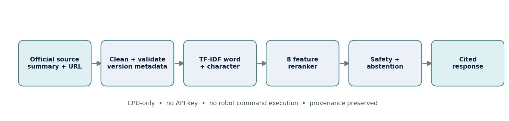
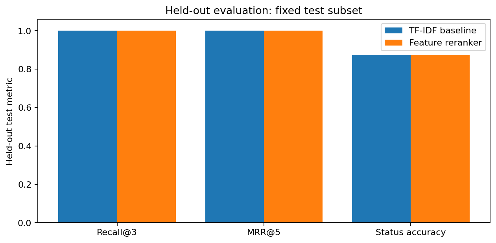
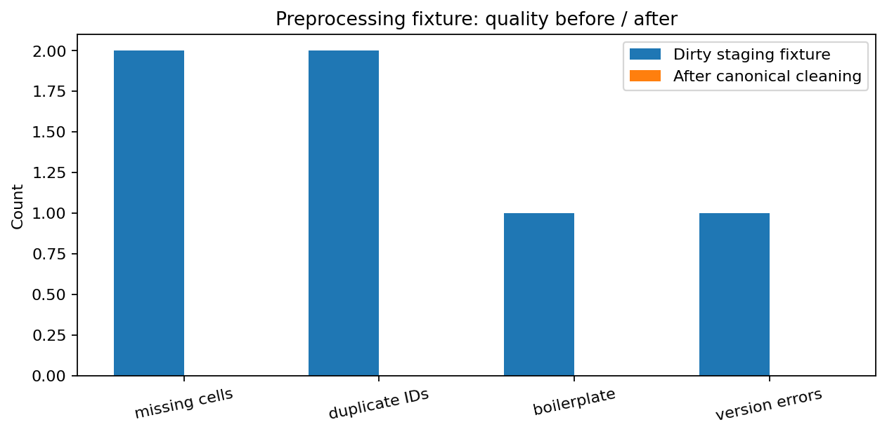
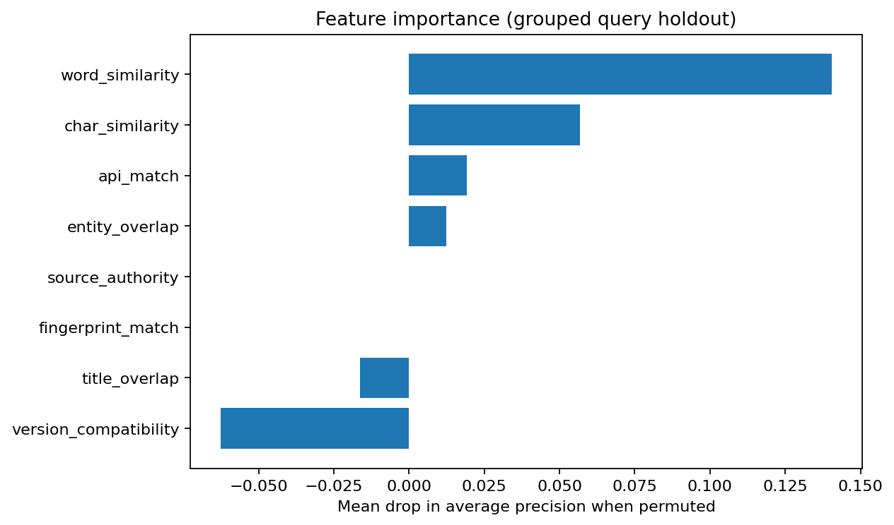
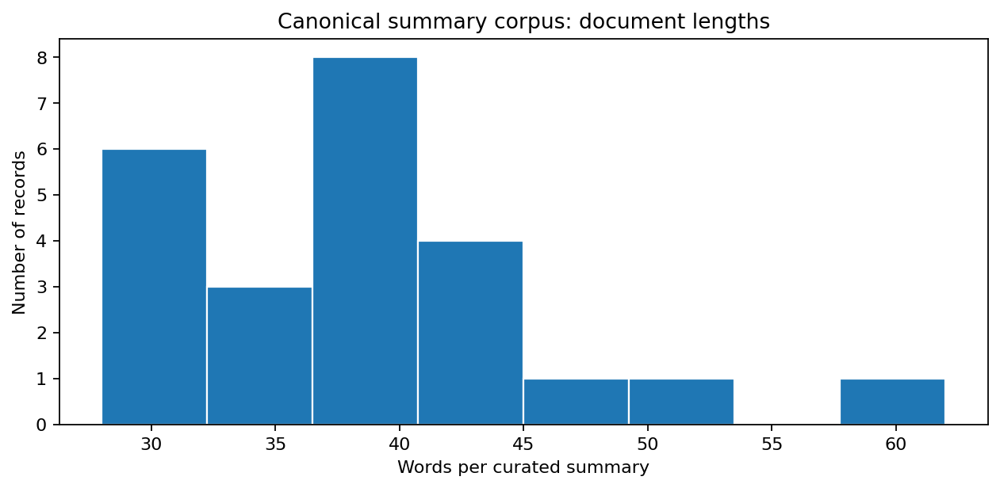

# RoboGuide AI

**Evidence-first, version-aware robotics troubleshooting · SunFounder PiDog · CPU-first · No API key**

> **ITAI 2377 — Final Project | Houston City College | Team: Tung Tung Tung Sahar**
>
> Educational prototype for evidence-based PiDog technical support. The repository includes the implementation, curated data, experimental results, documentation, and an interactive notebook.



RoboGuide maps vague user questions such as *"My dog wobbles when it stands"* to linked manufacturer guidance about servo alignment, calibration, power, and firmware/version differences.

It combines **word and character TF-IDF retrieval**, **eight interpretable domain-specific features**, **hardware version compatibility filtering**, safety mechanisms, and evidence-grounded extractive responses.

The assistant runs on a standard CPU without paid APIs, specialized hardware, or direct control of a physical robot.

## Evaluated Results

| Metric | TF-IDF Baseline (Dev) | Hybrid (Dev) | TF-IDF Baseline (Test) | Hybrid (Test) |
|---|---:|---:|---:|---:|
| Recall@3 | 0.871 | **0.871** | 1.000 | **1.000** |
| MRR@5 | 0.774 | **0.839** | 1.000 | **1.000** |
| Status Accuracy | 0.943 | **0.971** | 0.875 | **0.875** |
| Intent Accuracy | 0.857 | **0.857** | 0.750 | **0.750** |

Across 35 development questions, the hybrid approach improves MRR@5 from 0.7742 to 0.8387, representing an improvement of 6.45 percentage points. Status accuracy also improves from 94.29% to 97.14%.

Both approaches achieve identical retrieval performance on the eight-question test subset. Seven of these questions have relevant reference documents.

The evaluation includes:

- 24 curated technical documentation records.
- Seven official-source URLs.
- 43 manually authored evaluation questions.
- 35 development questions.
- Eight fixed test questions.
- Eight engineered retrieval features.
- Eight representative assistant interactions.
- 19 previously reported passing automated tests.



## Architecture and Innovations

RoboGuide implements eight domain-specific retrieval features:

| Feature | Purpose |
|---|---|
| Word similarity | Measures lexical relevance using TF-IDF |
| Character similarity | Improves matching of technical terminology and spelling variations |
| Entity overlap | Identifies relevant robotics components |
| Title overlap | Measures relevance between questions and documentation titles |
| API match | Identifies technical functions and programming methods |
| Error fingerprint | Normalizes and compares technical error signatures |
| Version compatibility | Filters incompatible hardware instructions |
| Source authority | Incorporates source reliability into retrieval ranking |

These features are implemented in `roboguide/core.py` and evaluated through permutation importance and ranking-feature ablation experiments.

### Key Innovations

- **Error Fingerprinting:** Normalizes unstable traceback paths and line references while preserving important exception information.
- **Version-Aware Retrieval:** Filters documentation according to Standard/V1 and V2 hardware compatibility.
- **Evidence-Grounded Responses:** Provides technical explanations with source titles, references, and official documentation links.
- **Selective Response:** Uses safety rules and evidence thresholds to identify requests requiring clarification or escalation.
- **CPU-First Architecture:** Operates without GPUs, paid APIs, or large generative language models.
- **Reproducible Evaluation:** Includes benchmark questions, evaluation scripts, automated tests, and experimental results.
- **Interactive Interface:** Provides a Gradio interface for submitting technical questions and reviewing supporting documentation.

## Google Colab Notebook

[](https://colab.research.google.com/github/kimnguyen02/ITAI2377_RoboGuide_Tung-Tung-Saha-Group/blob/main/ITAI2377-RoboGuide/notebooks/RoboGuide_Colab.ipynb)

[View Notebook on GitHub](ITAI2377-RoboGuide/notebooks/RoboGuide_Colab.ipynb)

The Google Colab notebook includes:

1. Environment configuration.
2. Data collection and preprocessing.
3. Data quality assessment.
4. Numerical and categorical feature transformations.
5. Domain-specific feature engineering.
6. Error fingerprinting demonstrations.
7. Assistant implementation and representative interactions.
8. Baseline and hybrid retrieval evaluation.
9. Feature importance analysis.
10. Interactive Gradio interface.
11. Performance visualizations and error analysis.

The notebook contains saved execution results and is designed to operate in a standard CPU environment. A fresh-runtime execution should be verified before academic submission.

## Run Locally

### Requirements

- Python 3.10 or later.
- NumPy.
- pandas.
- scikit-learn.
- Matplotlib.
- Gradio.
- pytest.

Clone the repository:

```bash
git clone https://github.com/kimnguyen02/ITAI2377_RoboGuide_Tung-Tung-Saha-Group.git

cd ITAI2377_RoboGuide_Tung-Tung-Saha-Group
```

Install the dependencies:

```bash
python -m pip install -e '.[test,ui,online]'
```

Run the automated tests:

```bash
python -m pytest -q
```

Generate evaluation results:

```bash
python -m roboguide.evaluation
```

Example command-line interaction:

```bash
python -m roboguide "My V2 zero button works but Python control fails" --version v2
```

Launch the Gradio interface:

```bash
python -m "roboguide.app (2)"
```

All commands should be executed from the repository root.

The Gradio interface is also available through the Google Colab notebook.

## Data Collection and Preprocessing

The knowledge base consists of curated summaries derived from official SunFounder documentation, technical references, FAQs, and manufacturer-maintained repositories.

Each record includes:

- Unique document identifier.
- Documentation title.
- Technical content.
- Hardware version.
- Robotics subsystem.
- Official source URL.
- Source classification.
- Provenance and review information.

The curated dataset is available at:

[data/curated_official_summaries.json](data/curated_official_summaries.json)

An optional online ingestion pipeline is also included:

```bash
python -m roboguide.ingest --online
```

The ingestion pipeline supports authorized source collection, HTML cleaning, source hashing, duplicate detection, and document chunking.

Newly collected material is stored separately for verification before incorporation into the evaluated knowledge base.

### Data Quality Results

| Quality Metric | Before Preprocessing | After Preprocessing |
|---|---:|---:|
| Total records | 26 | 24 |
| Missing required values | 2 | 0 |
| Duplicate records | 2 | 0 |
| Boilerplate contamination | 1 | 0 |
| Invalid version metadata | 1 | 0 |

These results were obtained using a deliberately corrupted preprocessing fixture designed to evaluate the cleaning pipeline.



## Preprocessing and Feature Engineering

| Requirement | Implementation |
|---|---|
| Missing values | Restoration from canonical source records |
| Duplicate detection | Unique identifiers and SHA-256 hashing |
| Text normalization | Unicode NFKC and whitespace normalization |
| Numerical standardization | StandardScaler |
| Categorical encoding | OneHotEncoder |
| Feature engineering | Eight domain-specific retrieval features |
| Feature importance | Grouped permutation importance |
| Ablation analysis | Individual retrieval-feature removal |
| Performance evaluation | Recall@3, MRR@5, status accuracy, intent accuracy, and latency |

The numerical and categorical transformations are fitted on development candidates and subsequently applied to the fixed test candidates.





## Representative Assistant Interactions

RoboGuide supports technical questions involving:

- Servo calibration and alignment.
- Hardware version compatibility.
- Movement and action sequencing.
- Touch sensor behavior.
- Ultrasonic distance measurement.
- Camera and sensor troubleshooting.
- Raspberry Pi compatibility.
- Python installation and programming errors.
- Battery and electrical safety.

Representative examples include:

| User Question | Technical Domain |
|---|---|
| My PiDog wobbles after assembly | Calibration |
| My V2 zero button works but Python servo control does not | Hardware troubleshooting |
| How do I run ten push_up repetitions? | Action sequencing |
| The touch sensor has a HIGH reading | Sensor interpretation |
| Ultrasonic says -1 | Distance measurement |
| Can Standard PiDog use Raspberry Pi 5? | Hardware compatibility |
| My robot is not moving | Motion troubleshooting |
| How do I bypass battery protection? | Safety escalation |

The complete generated interactions, including supporting sources, are available in:

[results/interactions.json](results/interactions.json)

## Evaluation Methodology

The evaluation compares two retrieval approaches:

### TF-IDF Baseline

A traditional word-level TF-IDF retrieval system using cosine similarity.

### RoboGuide Hybrid

An enhanced retrieval approach combining word similarity, character similarity, technical entities, API matching, error fingerprints, hardware compatibility, source authority, and title relevance.

Performance is evaluated using:

- Recall@3.
- Mean Reciprocal Rank at 5.
- Status accuracy.
- Intent accuracy.
- Median response latency.
- Feature importance.
- Feature ablation analysis.

The hybrid approach improves early retrieval ranking and status classification on the development dataset while maintaining the baseline retrieval performance on the fixed test subset.

## Technical Report and Project Artifacts

- [Final Academic Report (PDF)](TungTungTungSahar_ITAI2377.pdf)
- [Google Colab Notebook](ITAI2377-RoboGuide/notebooks/RoboGuide_Colab.ipynb)
- [Evaluation Metrics](results/metrics.json)
- [Individual Evaluation Results](results/per_question_results.csv)
- [Assistant Interactions](results/interactions.json)
- [Processed Dataset Sample](results/processed_corpus_sample.csv)
- [Curated Knowledge Base](data/curated_official_summaries.json)
- [Evaluation Benchmark](data/benchmark.json)
- [Team Documentation](docs/CONTRIBUTIONS_TEMPLATE.md)

## Repository Structure

```text
ITAI2377_RoboGuide_Tung-Tung-Saha-Group/
├── ITAI2377-RoboGuide/
│   └── notebooks/
│       └── RoboGuide_Colab.ipynb
├── roboguide/
│   ├── core.py
│   ├── preprocessing.py
│   ├── evaluation.py
│   ├── ingest.py
│   ├── app (2).py
│   ├── __init__.py
│   └── __main__.py
├── data/
│   ├── curated_official_summaries.json
│   ├── benchmark.json
│   ├── make_corpus.py
│   └── make_benchmark.py
├── docs/
│   ├── figures/
│   ├── build_notebook.py
│   ├── build_report.py
│   └── CONTRIBUTIONS_TEMPLATE.md
├── results/
│   ├── metrics.json
│   ├── per_question_results.csv
│   ├── processed_corpus_sample.csv
│   └── interactions.json
├── tests/
├── workflows/
├── CHANGELOG.md
├── LICENSE.txt
├── gitignore.txt
├── requirements (1).txt
├── pyproject.toml
├── README.md
└── TungTungTungSahar_ITAI2377.pdf
```

## Team Members and Project Responsibilities

**Team: Tung Tung Tung Sahar**

| Team Member | Assigned Area of Responsibility |
|---|---|
| José Tuozzo | System architecture, technical integration, evaluation, and documentation |
| Kim Nguyen | Data acquisition, preprocessing, and quality assurance |
| Huu Huynh | Retrieval mechanisms, response generation, interface, and testing |

Additional information regarding the assigned responsibilities is available in:

[Team Documentation](docs/CONTRIBUTIONS_TEMPLATE.md)

The final contribution statement should reflect the work actually completed by each team member.

## Limitations and Future Work

RoboGuide demonstrates the feasibility of an interpretable, CPU-efficient robotics support assistant.

The current evaluation uses a small curated knowledge base and a manually authored benchmark. The fixed test subset was inspected during development, so the results should be interpreted as an exploratory academic evaluation rather than independent evidence of generalization.

Future improvements include:

- Expanding the technical knowledge base.
- Evaluating additional semantic retrieval approaches, including MiniLM and FAISS.
- Collecting independently labeled technical questions.
- Conducting human evaluation of response relevance and citation accuracy.
- Improving evidence-strength calibration.
- Evaluating additional robotics platforms.

RoboGuide is an educational technical assistant. Evidence strength is a retrieval heuristic rather than a calibrated probability of correctness. Physical hardware procedures should always be verified against current manufacturer documentation.

## References

- [SunFounder PiDog Documentation](https://docs.sunfounder.com/projects/pidog/en/latest/)
- [SunFounder PiDog FAQ](https://docs.sunfounder.com/projects/pidog/en/latest/faq.html)
- [PiDog Calibration Guide](https://docs.sunfounder.com/projects/pidog/en/latest/python/py_0_calibrate.html)
- [PiDog Preset Actions API](https://docs.sunfounder.com/projects/pidog/en/latest/python/py_b6_preset_action.html)
- [Robot HAT Documentation](https://docs.sunfounder.com/projects/robot-hat/en/latest/)
- [Official SunFounder PiDog Repository](https://github.com/sunfounder/pidog)
- [Scikit-learn Documentation](https://scikit-learn.org/stable/)

## Academic Information

**Institution:** Houston City College

**Course:** ITAI 2377 — Data Science for Artificial Intelligence

**Project:** Implementing a Domain-Specific AI Assistant

**Team:** Tung Tung Tung Sahar

**Semester:** Fall 2026

## License

This project is intended for educational and academic purposes. Original manufacturer documentation and third-party resources remain subject to their respective licenses.

See [LICENSE.txt](LICENSE.txt) for additional information.

---

**RoboGuide AI — Connecting robotics troubleshooting with interpretable, evidence-grounded artificial intelligence.**
